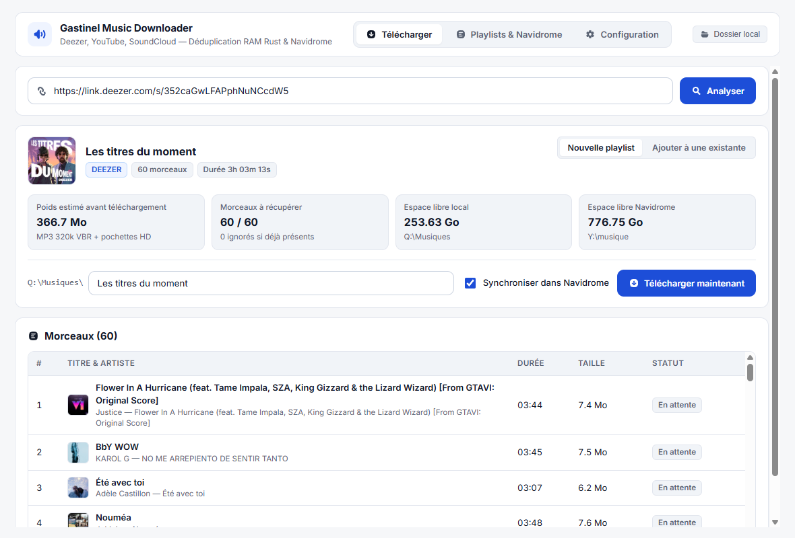
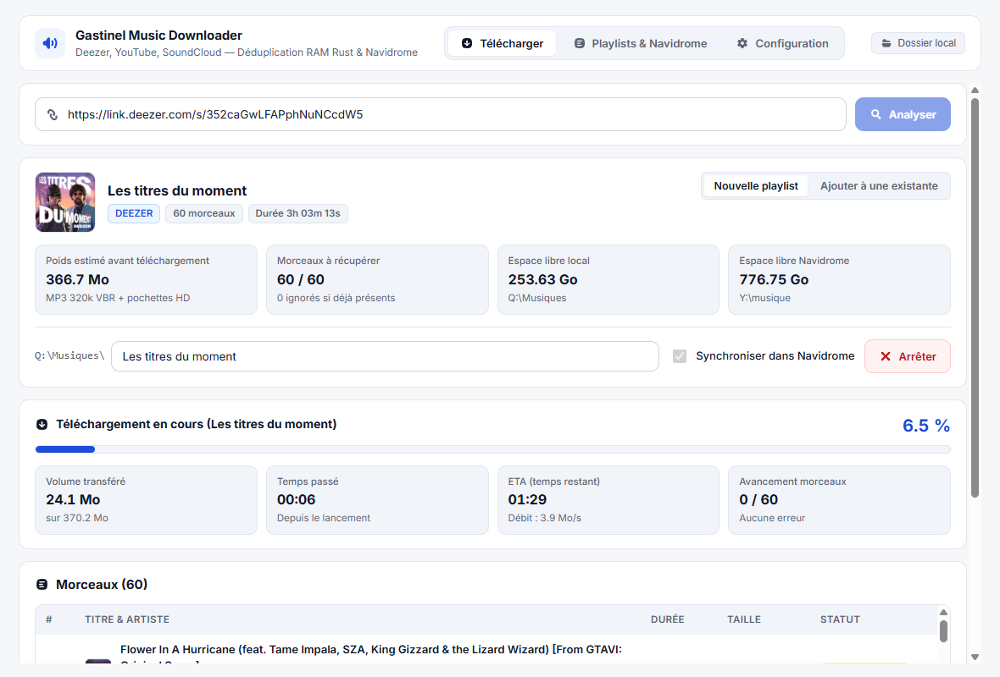
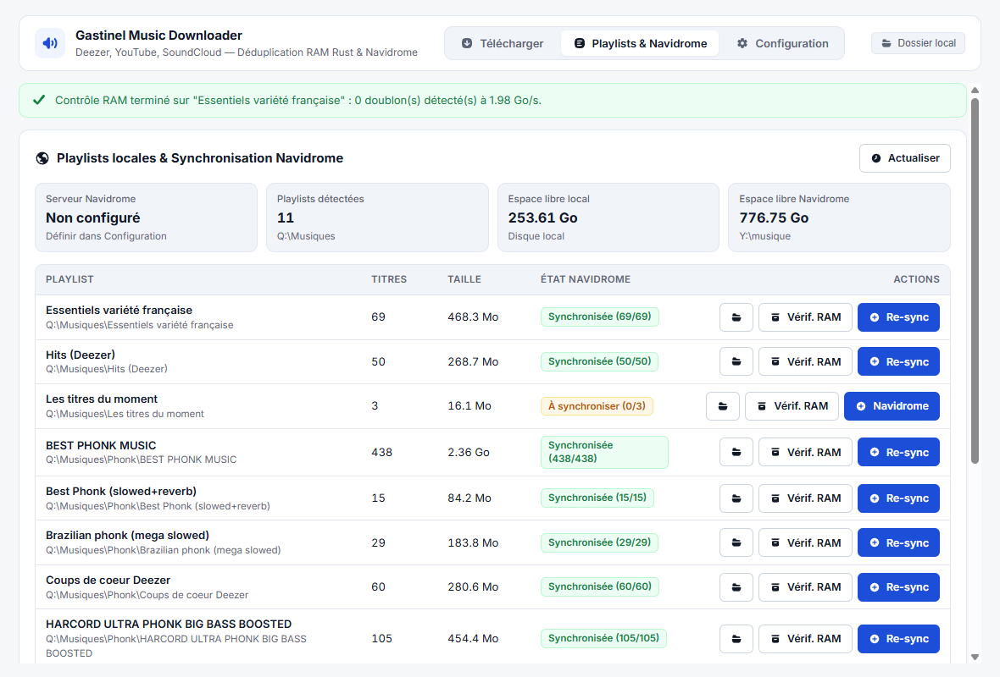
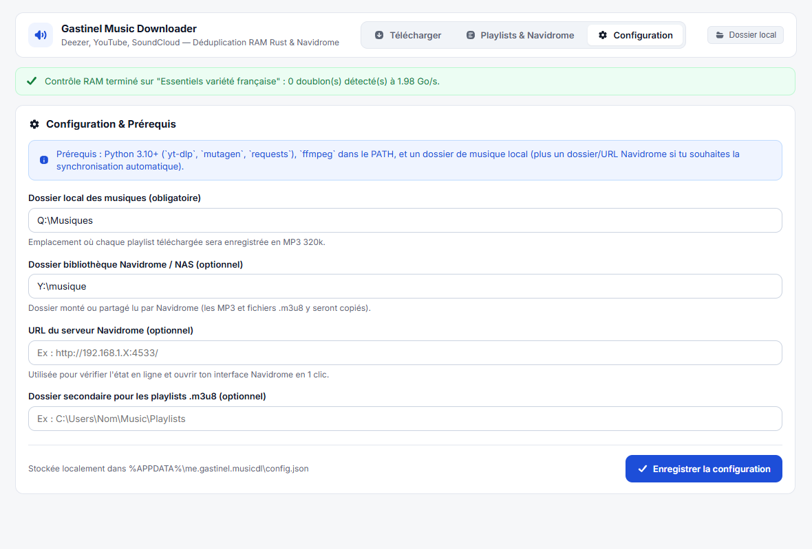

# Gastinel Music Downloader

Application de bureau Windows (**Tauri v2 + React/TypeScript + Rust + Python**) permettant d'analyser et de télécharger des playlists ou titres audio (Deezer, YouTube, SoundCloud) en haute qualité MP3 (320 kbps VBR + pochettes HD et tags ID3), de les fusionner dans des playlists existantes avec **vérification bit-à-bit en RAM en Rust**, et de les synchroniser vers **Navidrome**.

---

## Prérequis

Avant d'utiliser l'application, assure-toi d'avoir :

1. **Un dossier local pour ta musique** (ou une instance **Navidrome** avec son dossier bibliothèque accessible en local/réseau SMB).
2. **Python 3.10+** dans le `PATH`, avec les paquets suivants :
   ```powershell
   pip install yt-dlp mutagen requests
   ```
3. **FFmpeg** dans le `PATH` (pour l'extraction et la conversion MP3 haute qualité) :
   ```powershell
   winget install Gyan.FFmpeg.Essentials
   ```

---

## Fonctionnalités

- **Analyse avant téléchargement** : résolution des liens courts, affichage du nombre de titres, de la durée totale et du **poids estimé (Mo / Go)** avant de démarrer.
- **Suivi temps réel** : pourcentage (`%`), volume transféré (`Mo / Go`), débit (`Mo/s`), temps écoulé et ETA restant.
- **Ajout à une playlist existante + Déduplication bit-à-bit en RAM (Rust)** :
  - Compare chaque piste candidate **octet par octet en mémoire vive** contre les fichiers déjà présents pour bloquer tout doublon exact.
  - Génère un **rapport détaillé** avec la vitesse mémoire mesurée (`Mo/s` / `Go/s`), le temps de traitement (`ms`), les doublons bloqués et la mise à jour automatique du fichier `.m3u8`.
- **Synchronisation Navidrome** : copie les pistes et génère les playlists `.m3u8` dans le dossier Navidrome configuré.
- **Écran de configuration intégré** : aucun chemin ni adresse IP n'est codé en dur ; tout se règle dans l'onglet **Configuration** (`%APPDATA%\me.gastinel.musicdl\config.json`).

---

## Captures d'écran

### 1. Analyse & Estimation avant téléchargement


### 2. Suivi temps réel (`%`, `Mo/Go`, `ETA`, `Temps passé`)


### 3. Playlists, Navidrome & Vérification bit-à-bit en RAM (Rust)


### 4. Écran de configuration & prérequis


---

## Développement & Compilation

```powershell
# Frontend
npm.cmd install
npm.cmd run build

# Application Windows (.exe / .msi)
cd src-tauri
cargo tauri build
```

---

## Licence

Distribué sous licence **GNU GPL v3** — voir le fichier [LICENSE](LICENSE).
